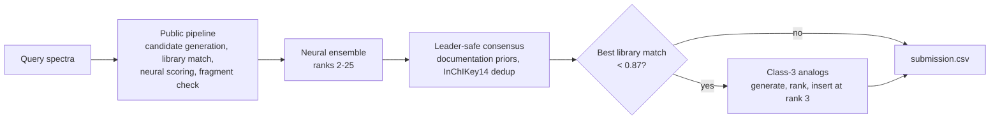

# Enveda CASMI 2026 — MS/MS to structure

Our solution for the Kaggle competition
[Enveda CASMI 2026](https://www.kaggle.com/competitions/enveda-CASMI26-molecule-id-mass-spectra):
given the tandem mass spectra of an unknown molecule, return a ranked list of up to 25 candidate structures.
Submissions are scored by **MRR@25**, with a candidate counted as correct when the first 14 characters of its InChIKey
(the connectivity block) match the answer.

**Best public LB: 0.482** (v7). The strongest public notebook at the time scored 0.480.

The solution is one Kaggle notebook, built on the strongest public pipeline, with our own stages added on top. This
repository holds the notebook and the code and offline benches behind every stage we added.

---

## Pipeline



| stage | what it does | where |
|---|---|---|
| Public pipeline | The pinned 0.465 → 0.479 public pipeline: candidate generation, spectral-library match, the public spectrum↔structure model, fragment check, leader-safe consensus | `notebooks/` (SHA-256-pinned inside the notebook) |
| Fragment scorer | MetFrag-lite rescorer: the share of MS/MS intensity explained by fragments that need at most two bond cleavages. Forked and benchmarked | `frag/` |
| Neural ensemble | Ranks 2–25 follow per-molecule z-scores of several spectrum↔structure models averaged together. The leader at rank 1 is never moved | notebook cell 11 |
| Class-3 analogs | For molecules the library cannot confirm: take the spectral neighbours, apply 41 mass-delta biotransformation rules, rank the products with LambdaRank and insert the top 3 at rank 3 | `class3/` |
| Isomer reranker | A learned same-formula reranker. It ships **off** because it lost on the board (see below) | `rerank/` |

Every stage we added fails safe: if a stage raises an error or times out, the notebook submits its input unchanged.

---

## Results

Public leaderboard. Each row is one submission and changes one thing against the row it builds on.

| version | change | public LB |
|---|---|---|
| base | Public 0.477 notebook (busyaprime), run unchanged | 0.477 |
| v1 | + ring-opening fragment credit 0.8 | 0.473 |
| v3 | 0.479 final merge layer, ring credit off | 0.479 |
| v4 | + class-3 analog insertion | 0.479 ¹ |
| v5 | class-3 placement probes: insert at rank 2 / at rank 1 / 5 inserts / gate 0.95 | 0.462 / 0.462 / 0.478 / 0.479 |
| v6 | + isomer rerank: leader kept / full rerank | 0.461 / 0.322 |
| **v7** | **v4 + two-model neural ensemble, `0.5·z(public) + 0.5·z(retrained)`** | **0.482** |
| v7 | ensemble weight 0.4 / 0.6 | 0.475 / 0.473 |
| v8 | + third model (long-schedule training), 1/3 each | 0.465 |

¹ The same rounded score as v3, but above it on the hidden decimals: the LB rank moved from about 190 to about 50.

### Offline benches

| bench | setup | result |
|---|---|---|
| Fragment scorer (`frag/bench.py`) | Rank the true structure among same-formula training isomers by fragment score alone | MRR 0.487 vs 0.447 for the upstream scorer on natural products (135 structures), 0.640 on GNPS (595) |
| Class-3 generation (`class3/bench.py`) | Remove the true structure and its analogs (Tanimoto ≥ threshold) from the library, then try to regenerate it from its spectral neighbours | Truth generated for 32–53% of the np-examples, 9–21% of held-out GNPS structures |
| Class-3 ranker (`class3/ranker.py`) | MRR@25 of generated candidates at Tanimoto exclusion 0.7 / 0.85 / 1.0 | 0.074 / 0.162 / 0.193; +0.053 [+0.036, +0.070] over the hand-tuned ranking |
| Isomer reranker (`rerank/ranker.py`) | Rerank same-formula isomers of 1,022 held-out structures with their spectra removed from the library | MRR@25 0.797 → 0.862 (+0.065 [+0.051, +0.079]) |

---

## What we learned

- **Never move ranks 1–2.** The pipeline's top of the list is hard to beat: any change there cost 0.017 (v5) or far
  more (v6). Gains came from reordering ranks 2–25 and from adding new structures lower in the list.
- **Ensemble scorers, don't replace them.** The second neural model added +0.003 as an ensemble member. Public
  authors report that the same model *replacing* the public one scored 0.460. A third, long-trained model
  pulled the ensemble down to 0.465: more members only help when each one is good on this data.
- **Offline wins don't always transfer.** The isomer reranker gained +0.065 MRR offline and lost 0.018 on the board.
  The bench's base ordering was far weaker than the pipeline's, and real lists are not same-formula isomer pools. The
  ring-opening credit improved the natural-product bench and still cost 0.004 on the board.
- **The board is noisy.** The pipeline skips optional stages when its time guards trip, so the same code can score a
  few thousandths apart between runs. Don't read a single-probe gap below ~0.003 as real.

---

## Repository layout

```
notebooks/casmi26-baseline-0477/   Kaggle notebook + kernel-metadata.json (data and kernel sources)
frag/                              fragment scorer fork, isomer bench, embedder into the notebook
class3/                            spectral-neighbour library, biotransformation rules, candidate builder,
                                   neural scorer re-implementation, LambdaRank ranker, notebook stage + embedder
rerank/                            isomer-reranker features, bench and ranker (kept for reference, off in the notebook)
data/                              competition data, caches and model bundles (not tracked)
```

## Reproducing

The project uses a local virtualenv in `.venv`. Put the competition files in `data/` (`train.parquet`,
`test.parquet`, `sample_submission.csv`) and the public spectrum model bundle in `data/models/`.

```bash
# offline benches
.venv/bin/python -I frag/bench.py --data data/train.parquet --out frag/results
.venv/bin/python -I class3/library.py --data data/train.parquet
.venv/bin/python -I class3/bench.py --out class3/results
.venv/bin/python -I class3/ranker.py --train class3/results_rank_train --eval class3/results_rank_eval
.venv/bin/python -I rerank/bench.py --n 2000 --out rerank/results
.venv/bin/python -I rerank/ranker.py --bench rerank/results --out rerank/model

# write the code into the notebook (idempotent; rerun after changing frag/ or class3/)
.venv/bin/python -I frag/embed.py notebooks/casmi26-baseline-0477/casmi26-baseline-0477.ipynb
.venv/bin/python -I class3/embed.py notebooks/casmi26-baseline-0477/casmi26-baseline-0477.ipynb

# run on Kaggle
uvx --with six kaggle kernels push -p notebooks/casmi26-baseline-0477
```

Kaggle constraints to keep in mind:
- **The kernel source must stay under 1 MB.** `class3/embed.py` stores its files zlib-compressed and base64-encoded
  for this reason; the notebook is about 920 KB.
- **The competition only accepts a file named `submission.csv`**, so each LB probe needs its own kernel.
- **The commit run is a smoke test** on the visible subset. Kaggle's scoring rerun on the hidden test runs every stage.

The stage switches live in the notebook's config cell: `CLASS3`, `CLASS3_CFG`, `NEURAL_W_OURS`, `NEURAL_LONG` (off),
`FRAG_W_RING`.

---

## Credits

This work stands on public notebooks and datasets from the competition community, in particular:
- **Pipeline and consensus layers:** Dmitrii Gluzdov, Saner Turhaner (sanpier), Roman Rozen, Roman Tamrazov,
  busyaprime, Kunal Desale, Baidalin Adilzhan.
- **Spectrum↔structure model:** Saner Turhaner (`sanpier/casmi-spectrum-model-v1`, Apache-2.0).
- **Neural ensemble recipe and retrained model:** bgunshui (`casmi26-scorer-train-public`).
- **Long-schedule model:** Ahmed Berat Özer (`casmi26-spectrum-model-long`).

Each dataset keeps its own license. See the attribution section inside the notebook for the full list.
